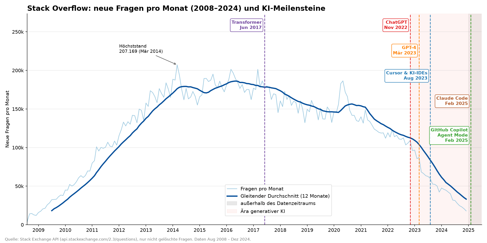

# Stack Overflow Challenge: KI-gestützte Datenvisualisierung

Nachbau des Stack-Overflow-Diagramms „Fragen über die Zeit“ (2008–2024) mit einem
gleitenden 12-Monats-Durchschnitt und Markierungen für sechs KI-Meilensteine.
Die Aufgabe steht [hier](https://l3gj0n.github.io/ai_supported_software_development_hs_aalen/de/exercises/01-stack-overflow-challenge/).



## Ausführen

Voraussetzung ist [uv](https://docs.astral.sh/uv/).

```bash
uv run v1.py                 # Daten holen (mit Cache) und Plot erzeugen
uv run v1.py --no-fetch      # nur aus data/so_questions_monthly.csv plotten
uv run v1.py --end 2025-12   # Datenzeitraum erweitern
uv run pytest                # Tests
```

Der Plot landet in `output/stackoverflow_questions.png`.

## Woher kommen die Daten?

Aus der [Stack Exchange API](https://api.stackexchange.com/docs/questions). Für jeden Monat
fragt das Skript

```
GET https://api.stackexchange.com/2.3/questions?site=stackoverflow
    &fromdate=<Monatsanfang>&todate=<Monatsende>&filter=total
```

ab. Der eingebaute Filter `total` liefert nur die Anzahl (`{"total": 15823}`) und keine
einzelnen Fragen. Pro Monat braucht es also genau eine Anfrage.

- **Kontingent:** Ohne Key sind 300 Anfragen pro IP und Tag erlaubt. 2008-08 bis 2024-12
  sind 197 Anfragen. Mit der Umgebungsvariable `SE_API_KEY` steigt das Limit auf 10 000.
- **Cache:** Nach jedem Monat wird `data/so_questions_monthly.csv` gespeichert. Ein
  abgebrochener Lauf macht beim nächsten Start dort weiter, wo er aufgehört hat.

## Stolperfallen („die letzten 20 %“)

| Problem | Lösung |
|---|---|
| Stack Overflow ist am 31.07.2008 gestartet. Juli 2008 enthält also nur einen Tag und wäre ein künstlicher Ausreißer. | Die Daten beginnen im August 2008. |
| Monatsgrenzen: Ist `todate` inklusiv? Sonst könnte eine Sekunde doppelt gezählt werden. | `todate` = nächster Monatsanfang − 1 s, gerechnet in UTC. Ein Test prüft das, auch für Schaltjahr-Februare. |
| Der gleitende Durchschnitt würde in den ersten 11 Monaten über weniger Werte mitteln. | `min_periods=12`, d. h. die Linie beginnt erst nach 12 Monaten. Das Fenster ist nachlaufend (trailing). |
| Die API zählt nur **nicht gelöschte** Fragen. | Das gilt genauso für das Original-Diagramm aus dem Stack Exchange Data Explorer und steht in der Fußnote. Ältere Monate sind dadurch etwas niedriger als die damals tatsächlich gestellten Fragen. |
| Claude Code und Copilot Agent Mode (Feb 2025) liegen nach dem Datenende (Dez 2024). | Die x-Achse ist bis Mitte 2025 verlängert, der Bereich ohne Daten ist grau hinterlegt. |
| Beide Meilensteine im Feb 2025 fallen auf denselben Monat. | Die Beschriftungen stehen in gestaffelter Höhe. |
| `%b` liefert Monatsnamen je nach OS-Locale. | Deutsche Monatsnamen sind fest im Code hinterlegt. |
| Unvollständige Monate würden dauerhaft im Cache landen. | `--end` muss ein abgeschlossener Monat sein. |

## Dateien

| Datei | Inhalt |
|---|---|
| `v1.py` | Abruf, Cache, gleitender Durchschnitt und Plot |
| `test_v1.py` | Offline-Tests (API gemockt) |
| `data/so_questions_monthly.csv` | Abgerufene Monatswerte |
| `output/stackoverflow_questions.png` | Ergebnis |
| `PROMPTS.md` | Protokoll aller Prompts an die KI |
